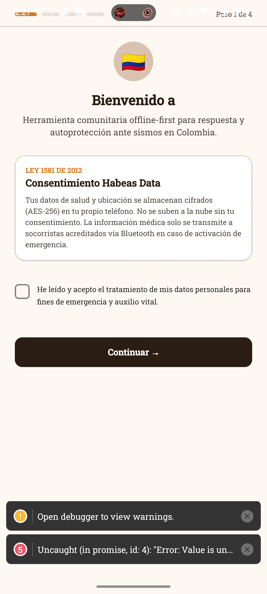
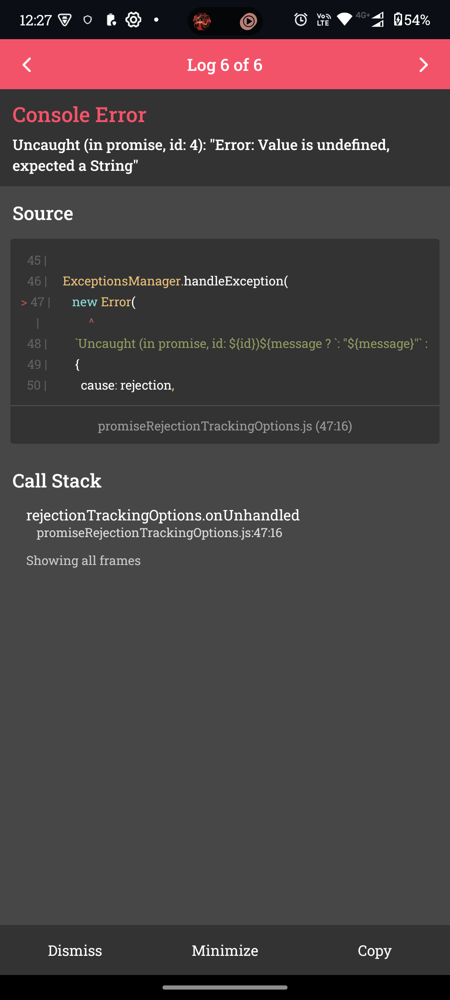
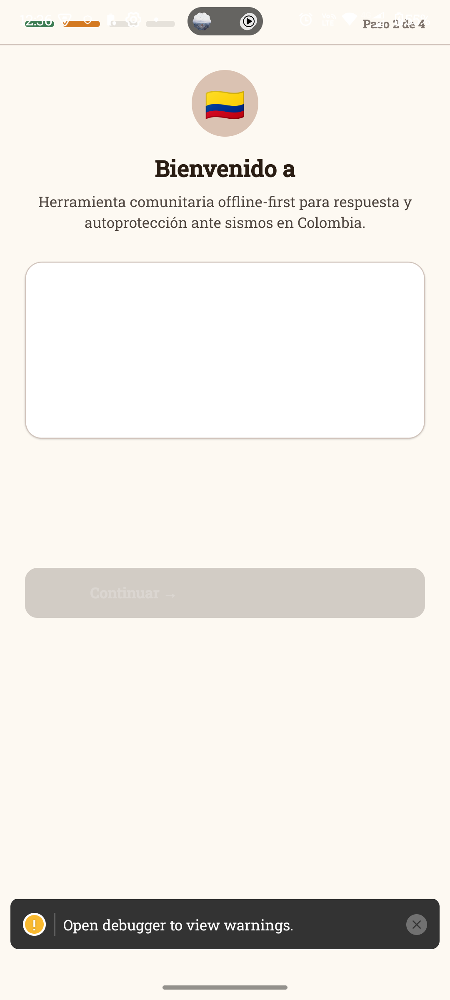
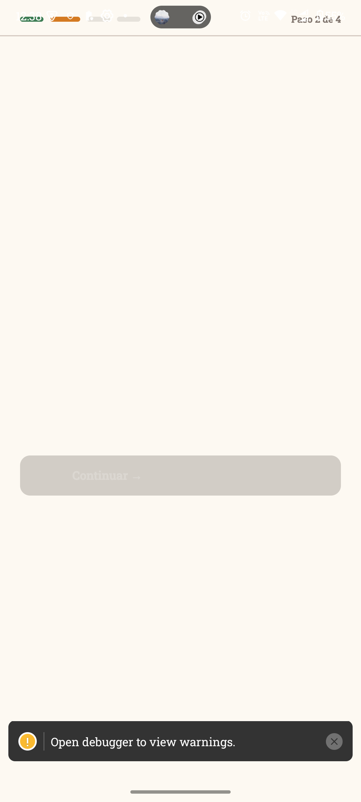
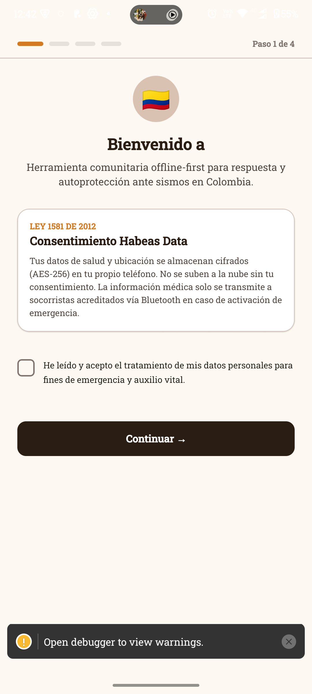
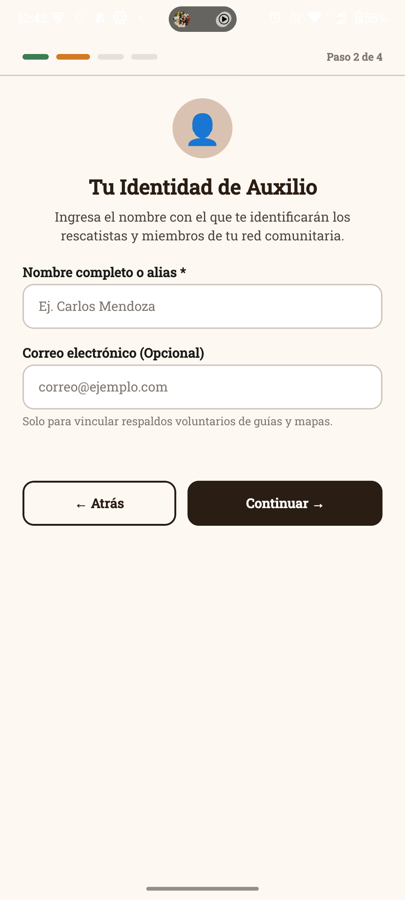
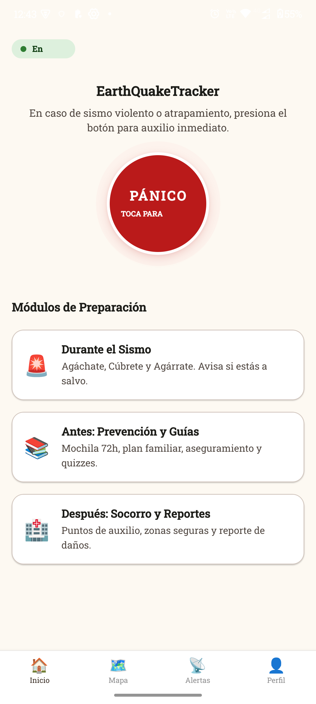

> **Nota:** este resumen cubre solo los 3 primeros fallos. El registro completo (41 fallos corregidos y 9 hallazgos abiertos, con capturas) está en `docs/Historial_de_Fallos.docx`, y los resultados por requisito en `docs/Informe_Pruebas_Funcionales.docx`.

# Fallos encontrados en la primera prueba en dispositivo (Android)

**Fecha:** 2026-10-12 · **Dispositivo:** Motorola edge 50 fusion, Android 15 · **Build:** debug, RN 0.87.1 (Fabric / nueva arquitectura, Hermes)

Hasta esta prueba, el código pasaba `tsc` y los 136 tests de Jest, pero **nunca se había ejecutado en un teléfono**. Estos tres fallos solo aparecieron al correrlo de verdad. Las capturas están en `docs/evidencia/`.

---

## Fallo 1 · Las bases SQLite se abrían sin clave de cifrado (RNF-04)

**Síntoma:** al arrancar, 5 errores rojos `Uncaught (in promise, id: 0..4): "Error: Value is undefined, expected a String"`.

| Error en pantalla | Detalle en LogBox |
|---|---|
|  |  |

**Cómo se aisló:** se activaron los registrars de `bootstrap.ts` de uno en uno y se contaron los errores en `logcat`. Con `core`, `emergency`, `poi`, `mesh` y `sensors` hubo 0 errores; con `sync` hubo 5. El registrar de `sync` abre su base de inmediato al leer la cola.

**Causa raíz:** `src/platform/core/SqliteKeyValueStore.ts` abría la base con `open({ name, location: undefined, encryptionKey: undefined })`. Con SQLCipher activo (`op-sqlite.sqlcipher = true`), el módulo nativo exige Strings. Además, esto significaba que **los datos no iban cifrados**, lo que incumple RNF-04 (AES-256 en la base local) y RF-04 (ficha médica cifrada). Las tres bases (`eqt_secure_data`, `eqt_sync_reports`, `eqt_sensors_alerts`) tenían el mismo defecto, aunque solo `sync` falló al inicio porque las otras abren la base de forma perezosa.

**Corrección:**
- Nuevo `src/platform/core/DatabaseKey.ts`: genera 256 bits aleatorios la primera vez y los guarda en Keystore (Android) / Keychain (iOS).
- `SqliteKeyValueStore` usa esa clave por defecto y ya no envía campos indefinidos al módulo nativo.

**Por qué los tests no lo detectaron:** los tests del core corren en Node con almacenes en memoria; nunca tocan `op-sqlite`.

---

## Fallo 2 · Faltaba `crypto.getRandomValues` en Hermes

**Síntoma:** tras el arreglo anterior, los mismos 5 errores pasaron a decir `Error: crypto.getRandomValues must be defined`.

**Evidencia (logcat):**
```
E ReactNativeJS: [Error: Uncaught (in promise, id: 0): "Error: crypto.getRandomValues must be defined"]
```

**Causa raíz:** `@noble/hashes` (usado para generar la clave de la base, el salt del PIN, nonces y el ID efímero BLE) pide `crypto.getRandomValues`, que Hermes no trae. Sin esto no se puede crear cuenta, cifrar la ficha ni emitir una baliza firmada.

**Corrección:** dependencia `react-native-get-random-values`, importada en la primera línea de `index.js`.

---

## Fallo 3 · `SafeAreaView` de React Native roto en Android 15: pantallas en blanco o con contenido fantasma

**Síntoma:** en el onboarding, al pasar del paso 1 al 2, la pantalla se quedaba con el título "Bienvenido a" (cortado) del paso 1, una tarjeta blanca vacía y el botón deshabilitado, aunque el contador ya decía "Paso 2 de 4". En una variante quedaba totalmente en blanco.

| Paso 2: contenido del paso 1 + tarjeta vacía | Paso 2 en blanco (tras probar otros parches) |
|---|---|
|  |  |

**Evidencia (logcat):** el árbol de vistas nativo no coincidía con el de React.
```
ReactNoCrashSoftException: Unable to find viewState for tag: [166] for removeViewAt
ReactNoCrashSoftException: Unable to find viewState for tag: [166] for addViewAt
```
Además, la cabecera quedaba **debajo de la barra de estado**: se ve en la primera captura que el indicador de pasos solapa la hora y la batería.

**Qué se descartó antes de dar con la causa** (cada intento se probó en el teléfono):
- `key` única por paso (forzar remonte): sin efecto.
- Quitar `accessibilityRole="none"` de `Card`: sin efecto.
- `collapsable={false}` y `removeClippedSubviews={false}`: cambió el fallo a pantalla en blanco.
- Cambiar `ScrollView` por `View`: el paso 2 se dibujaba, lo que señalaba al contenedor, no al contenido.

**Causa raíz:** el `SafeAreaView` de `react-native` está obsoleto (el propio runtime avisa `SafeAreaView has been deprecated`) y en Android 15 con *edge-to-edge* calcula mal los insets, lo que desincroniza el árbol de Fabric. Se usaba en 28 archivos de `src/ui`.

**Corrección:** reemplazo por `SafeAreaView` de `react-native-safe-area-context` (ya instalado) en los 28 archivos. Se retiraron los parches de prueba. Resultado: 0 excepciones de `MissingViewState` y la cabecera queda bajo la barra de estado.

| Paso 1 corregido | Paso 2 corregido |
|---|---|
|  |  |

---

## Resultado tras las tres correcciones

Flujo completo en el teléfono: consentimiento → nombre → PIN de 6 dígitos → resumen → "Comenzar a usar la App" (Argon2id + Keystore + SQLCipher) → Inicio con la app en servicios reales y 0 errores en el log.



## Observaciones menores pendientes (no bloqueantes)
- Inicio: la píldora de estado muestra "En" (se corta "En Línea").
- Inicio: el texto del botón de pánico, "TOCA PARA", aparece cortado y desalineado.
- Aviso de desarrollo `Open debugger to view warnings` (LogBox) visible en todas las capturas; no aparece en builds de release.

## Lección para el proceso
`tsc` + Jest en Node no son suficientes para el código nativo (SQLCipher, Keystore, Hermes, Fabric). Cada paquete que toque módulos nativos debe tener al menos una prueba de humo en dispositivo antes de darse por terminado. Pendientes de probar en dispositivo: flash/tono (RF-06), BLE y malla (RF-07/08, requiere un segundo teléfono), sensores (RF-09), sync (RF-12), mapa y GPS (RF-10), y el resto de pantallas.
